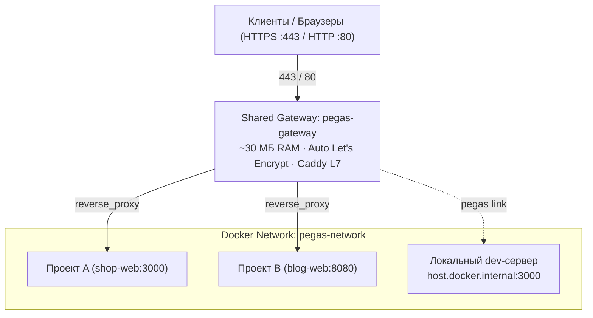

# pegas

> **Bun-native, agent-first оркестратор окружений и L7 reverse-proxy на базе Caddy для Docker.**
> Хостите сколько угодно сайтов и API на одном VPS: без конфликтов портов,
> с автоматическим Let's Encrypt SSL, строгой изоляцией секретов и hot-reload без даунтайма.
> Создан, чтобы быть надёжным и для разработчиков, и для ИИ-агентов (Cursor, Claude Code, Cline, Copilot).

[](https://www.npmjs.com/package/@netrunner714/pegas)
[](https://github.com/netrunner714/pegas/actions/workflows/ci.yml)
[](LICENSE)
[](package.json)
[](package.json)

---

## Архитектура решения

Один легковесный Caddy-шлюз (`pegas-gateway`, ~30 МБ RAM) держит стандартные порты `80` и `443`. Все проекты работают в изолированной Docker-сети `pegas-network` со скоуп-алиасами (`<проект>-<сервис>`), а маршрутизация описывается в едином декларативном контракте `pegas.json`.



### Ключевые преимущества:
* **Чистый `package.json`**: Pegas принципиально не мутирует и не оборачивает команды секции `scripts` (никаких навязанных скриптов `dev` или `deploy`).
* **Локальный HTTPS через `link` / `unlink`**: `pegas link` регистрирует dev-маршруты в общем шлюзе (`*.localhost` → `host.docker.internal:<порт>`), а `pegas unlink` освобождает их. Разработчик запускает локальный сервер нативно (`bun run dev`, `cargo run`, `go run`).
* **Единый деплой по сценарию**: `pegas deploy -s <scenario>` — целевой сценарий передается строго через флаг (`-s production`, `-s stage` и др.), исключая путаницу окружений и неявные алиасы.
* **Строгий аудит (`pegas check`)**: проверка 1:1 паритета секретов между `pegas.json`, `.env` и `.env.example`, запрет закомментированных присваиваний и защита через `.gitignore`.
* **Zero 502 Bad Gateway**: шлюз Caddy переключает трафик на новый контейнер только после успешного прохождения readiness-проб и healthcheck.
* **Анти-хайджекинг**: Pegas блокирует развертывание, если домен уже закреплен за другим проектом на сервере.
* **Zero Dependencies**: собран на чистом TypeScript под Bun и Node.js 24+ без сторонних npm-зависимостей в `dependencies`.

---

## Быстрый старт

### 1. Инициализация проекта

В корне любого репозитория выполните:

```bash
bunx @netrunner714/pegas init
# или
npx @netrunner714/pegas init
```

Команда автоматически определит стек проекта, создаст декларативный контракт `pegas.json`, шаблоны секретов (`.env.example`, `.env`), добавит `.pegas` в `.gitignore` и создаст правила `docs/pegas.md` для ИИ-агентов.

### 2. Локальная разработка с HTTPS (`*.localhost`)

```bash
# 1. Установить локальный доверенный Root CA (выполняется один раз на машине)
bunx pegas ca install

# 2. Подключить проект к локальному шлюзу
bunx pegas link

# 3. Запустить проект привычной для вас командой разработки
bun run dev # или: cargo run, go run и т.д.
```

Проект мгновенно доступен по доверенному HTTPS: `https://<проект>.localhost`.

После окончания работы отключите проект от шлюза:
```bash
bunx pegas unlink
```

### 3. Деплой на VPS

На сервере развертывание выполняется строго с указанием сценария из `pegas.json`:

```bash
# Деплой production-сценария
bunx pegas deploy -s production

# Или деплой staging-сценария
bunx pegas deploy -s stage
```

Pegas развернет изолированные контейнеры, дождется readiness-проб, зарегистрирует маршруты в Caddy, автоматически получит сертификаты Let's Encrypt и выполнит бесшовный hot-reload.

---

## Основные команды CLI

| Команда | Описание |
|---|---|
| `pegas init` | Создать контракт `pegas.json`, шаблоны секретов и документацию для агентов |
| `pegas link` | Подключить локальный проект к шлюзу (`*.localhost` → локальный порт хоста) |
| `pegas unlink` | Отключить проект от шлюза и освободить dev-маршруты |
| `pegas deploy -s <scenario>` | Развернуть проект по сценарию из `pegas.json` (`-s production`, `-s stage` и др.) |
| `pegas logs -f [service]` | Потоковый просмотр логов контейнеров (Ctrl+C отключает только логи) |
| `pegas status` | Дашборд шлюза: домены, upstream-адреса, статус контейнеров и healthcheck |
| `pegas check` | Полный аудит контракта, соответствия секретов и безопасности |
| `pegas down` | Остановить контейнеры проекта и удалить его маршруты из шлюза |
| `pegas ca <install\|remove>` | Управление доверенным системным Root CA для локального HTTPS |
| `pegas update` | Обновить Pegas до актуальной версии (`--latest` для мажорных обновлений) |

Полный справочник всех флагов и опций: [docs/reference/cli.md](docs/reference/cli.md).

---

## Контракт `pegas.json`

Файл `pegas.json` хранится в корне проекта и коммитится в Git — это **единственный источник истины** об архитектуре окружения:

```jsonc
{
  "$schema": "https://netrunner714.ru/schemas/pegas.json",
  "projectName": "my-cool-app",
  "runtime": "docker",

  // 1. Обязательные секреты: 1:1 соответствие с .env и .env.example
  "secrets": [
    "DATABASE_URL",
    "API_SECRET",
    "TELEGRAM_BOT_TOKEN"
  ],

  // 2. Глобальный env: ТОЛЬКО карта сценариев или макросы ${services...}
  // (Статические скаляры задаются внутри конкретного сервиса в services.*.env)
  "env": {
    "FEATURE_NEW_CHECKOUT": {
      "development": "true",
      "stage": "true",
      "production": "false"
    },
    "PUBLIC_API_URL": {
      "development": "${services.api.url}",
      "stage": "${services.api.url}",
      "production": "${services.api.url}"
    }
  },

  // 3. Параметры деплоя (опционально)
  "deploy": {
    "strictDns": false,
    "skipDnsCheck": false,
    "skipReadiness": false
  },

  // 4. Декларация сервисов проекта
  "services": {
    "web": {
      "role": "app",
      "port": 3000,
      "build": {
        "context": ".",
        "dockerfile": "Dockerfile",
        "target": "runner"
      },
      // Домены с явным указанием сценариев (development, stage, production)
      "domains": {
        "development": ["my-cool-app.localhost"],
        "stage":       ["staging.mycoolapp.com"],
        "production":  ["mycoolapp.com", "www.mycoolapp.com"]
      },
      // L7-маршрутизация путей и WebSocket
      "routes": {
        "/api/*": "api:4000",
        "/ws/*": { "to": "api:4000", "websocket": true }
      },
      // Настройка CORS
      "cors": {
        "origin": ["https://mycoolapp.com"],
        "credentials": true
      },
      // Очередность старта с условием готовности
      "dependsOn": {
        "postgres": { "condition": "service_healthy" }
      },
      // Сервисные несекретные переменные (скаляры разрешены здесь)
      "env": {
        "NODE_ENV": "production",
        "PORT": "3000",
        "DATABASE_URL": "${services.postgres.internalUrl}"
      },
      "envFile": ".env"
    },

    "api": {
      "role": "app",
      "port": 4000,
      "build": {
        "context": "./apps/api",
        "dockerfile": "Dockerfile"
      },
      "domains": {
        "development": ["api.my-cool-app.localhost"],
        "stage":       ["stage-api.mycoolapp.com"],
        "production":  ["api.mycoolapp.com"]
      },
      "dependsOn": {
        "postgres": { "condition": "service_healthy" }
      }
    },

    "postgres": {
      "role": "infra",
      "image": "postgres:18-alpine",
      "ports": ["5432:5432"],
      "volumes": ["pgdata:/var/lib/postgresql/data"],
      "healthcheck": {
        "test": ["CMD-SHELL", "pg_isready -U postgres"],
        "interval": "5s",
        "timeout": "3s",
        "retries": 5
      }
    }
  }
}
```

---

### Справочник полей `pegas.json`

#### Корневые поля

| Поле | Тип | Описание |
|---|---|---|
| `$schema` | `string` | URL схемы: включает подсказки и валидацию контракта в IDE. |
| `projectName` | `string` | Уникальный slug проекта: задает сетевые алиасы и имя конфигурации в Caddy. |
| `runtime` | `"docker" \| "host"` | Режим рантайма. По умолчанию `"docker"` для современных проектов. |
| `secrets` | `string[]` | Строгий список обязательных переменных окружения (паритет 1:1 с `.env` и `.env.example`). |
| `env` | `object` | **Глобальный конфиг проекта**: карта сценариев (`development`, `stage`, `production`) или макросы `${services...}`. Статические скаляры на глобальном уровне запрещены. |
| `services` | `object` | Декларация контейнеров проекта (ключ — имя сервиса). |
| `deploy` | `object` | Тонкая настройка деплоя: `strictDns`, `skipDnsCheck`, `skipReadiness`. |
| `devGateway` | `object` | Настройки локального шлюза: `httpPort`, `httpsPort`, `skipInstallTrust`, `admin`. |

#### Поля сервиса (`services.<name>`)

| Поле | Тип | Описание |
|---|---|---|
| `role` | `"app" \| "infra"` | Классификация сервиса (`app` — веб-приложения с доменами, `infra` — БД, Redis). |
| `port` | `number \| string` | Порт, который приложение слушает внутри контейнера (например, `3000`). |
| `ports` | `string[]` | Прямая публикация портов на хост (Compose синтаксис: `["5432:5432"]`). Для прямого доступа к БД. |
| `domains` | `object` | Карта доменов по сценариям: `development`, `stage`, `production` (поддерживаются IDN-домены). |
| `routes` | `object` | L7-маршрутизация подпутей Caddy: проксирование путей (напр. `{"/api/*": "api:4000"}`). |
| `cors` | `object \| boolean` | Автоматическая генерация CORS-заголовков (`origin`, `methods`, `credentials`). |
| `build` | `object` | Сборка Docker-образа: `context`, `dockerfile`, `target` (multi-stage), `args`. |
| `image` | `string` | Готовый образ Docker (взаимоисключимо с `build`). |
| `command` | `string[]` | Команда запуска контейнера (переопределяет CMD образа). |
| `env` | `object` | **Сервисные переменные**: здесь разрешены статические скаляры (`"NODE_ENV": "production"`). |
| `envFile` | `string` | Относительный путь к файлу секретов (передается в Docker без сохранения в манифестах). |
| `volumes` | `string[]` | Тома данных в формате Compose (`["pgdata:/var/lib/postgresql/data"]`). |
| `dependsOn` | `object \| string[]` | Зависимости сервиса с условием готовности (`service_healthy`, `service_started`). |
| `healthcheck` | `object` | Проба готовности контейнера Docker: `test`, `interval`, `timeout`, `retries`. |
| `hmr` | `object` | Режим отслеживания файлов для контейнерного dev (`fileWatch: "auto" \| "events" \| "polling"`). |

#### Доступные макросы `${services.<имя>.<свойство>}`:
* `${services.<svc>.url}` — полный публичный URL со схемой (`http://` на dev, `https://` на stage/prod).
* `${services.<svc>.wsUrl}` — WebSocket URL со схемой (`ws://` на dev, `wss://` на stage/prod).
* `${services.<svc>.host}` — домен сервиса без протокола.
* `${services.<svc>.port}` — внутренний порт сервиса (`"3000"`).
* `${services.<svc>.internalUrl}` — адрес во внутренней Docker-сети с авто-протоколом (`http://web:3000`, `postgresql://...`).

---

## Для ИИ-агентов

Pegas изначально спроектирован с расчетом на автономную работу AI-агентов (Cursor, Claude Code, Cline, Copilot):

* **Строгий JSON-режим**: любая команда поддерживает флаг `--json` с детерминированным машиночитаемым выводом.
* **Bun-first стандарт**: выполнение скриптов хоста стандартизировано на Bun (`bun run <cmd>`).
* **Никаких интерактивных зависаний**: команды никогда не блокируют терминал вопросами или промптами.
* **Контекст в одном файле**: команда `bunx pegas llms` и файл [llms.txt](llms.txt) содержат компактное, полное описание архитектуры, контракта и команд.
* **Самодиагностика и исправление**: `pegas check --fix` находит несоответствия секретов или `.gitignore` и автоматически их исправляет.

---

## Документация

| Раздел | Содержание |
|---|---|
| [Быстрый старт](docs/tutorials/quickstart.md) | Пошаговое руководство от инициализации до деплоя |
| [Руководства (How-To)](docs/how-to/) | Решение конкретных задач: [инициализация](docs/how-to/init.md), [локальный HTTPS](docs/how-to/local-https.md) |
| [Справочники](docs/reference/) | [CLI](docs/reference/cli.md) (автогенерируемый из кода), [контракт pegas.json](docs/reference/contract.md) |
| [Архитектура](docs/explanation/architecture.md) | Внутреннее устройство Pegas и обоснование технических решений |
| [Контекст для агентов](llms.txt) | Полный контекст для AI-ассистентов |

---

## Лицензия

MIT © [NETRUNNER714](https://netrunner714.ru)
