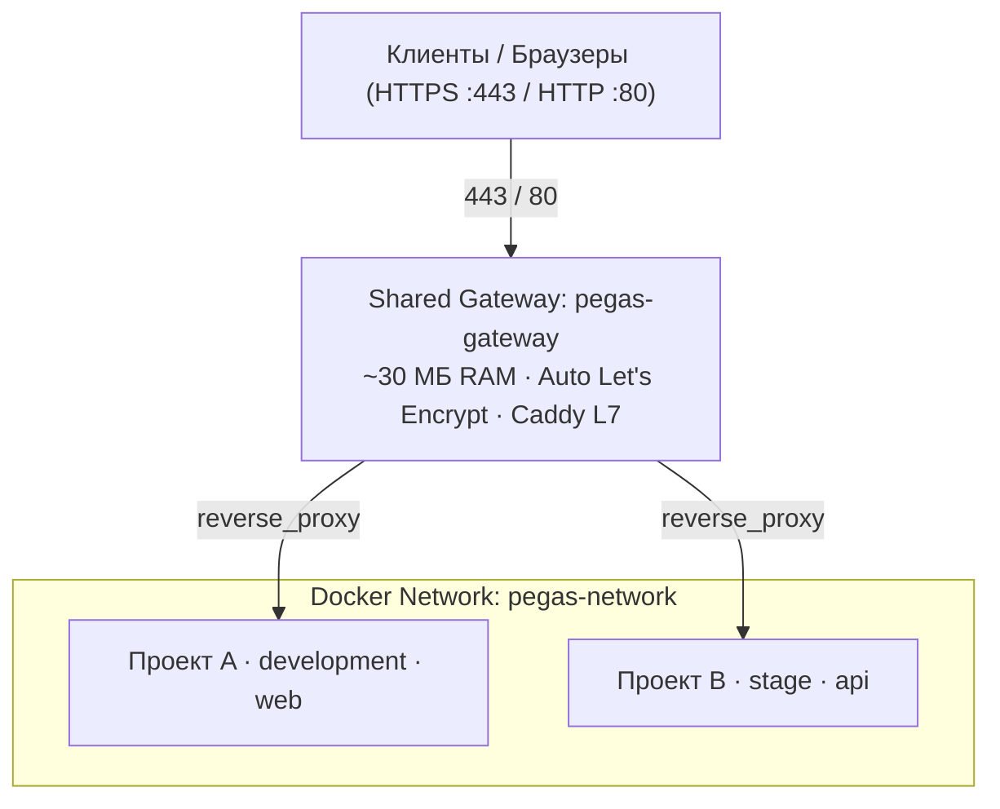

# pegas

> **Оркестратор окружений и L7 reverse-proxy на базе Caddy для Docker, спроектированный для ИИ-агентов.**
> Хостите сколько угодно сайтов и API на одном VPS: без конфликтов портов,
> с автоматическим Let's Encrypt SSL, строгой изоляцией секретов и hot-reload без даунтайма.
> Один декларативный контракт `pegas.json` заменяет docker-compose, Caddyfile и списки CORS-доменов.

[](https://www.npmjs.com/package/@netrunner714/pegas)
[](https://github.com/netrunner714/pegas/actions/workflows/ci.yml)
[](LICENSE)
[](package.json)
[](package.json)

---

## Что такое Pegas

Pegas — это L7-шлюз и оркестратор локальной инфраструктуры. Он заменяет всю
инфраструктурную обвязку, которая обычно копится в репозитории:

| Что исчезает из репо | Чем заменяется |
|---|---|
| `docker-compose.yml` | манифест генерируется из `pegas.json` на каждый деплой (эфемерный, не хранится) |
| `Caddyfile`, конфиги обратного прокси | маршруты и TLS шлюз строит из `domains` контракта |
| Ручные списки CORS-доменов | пегас знает все домены проекта и сам настраивает заголовки (`services.<name>.cors`) |
| env «про топологию» (порты, адреса соседей, NODE_ENV) | вычисляется пегасом, код читает готовые значения через Runtime SDK |

`pegas.json` в корне репо — единственный источник истины о топологии.

### Архитектура

Один легковесный Caddy-шлюз (`pegas-gateway`, ~30 МБ RAM) держит порты 80 и 443.
Все проекты работают в изолированной Docker-сети `pegas-network` со скоуп-алиасами
(`<проект>-<сценарий>-<сервис>`). Контейнерная статика (например, Caddyfile
для file_server внутри образа) — легитимна и не является конфигом шлюза.



### Ключевые принципы

* **Zero Scalars**: каждое поле, зависящее от среды, — строгая карта сценариев (`runtime`, `image`, `port`, `domains` и др.). Корневого `env`, `secrets`, `role`, `deploy` нет.
* **Сценарии вместо окружений**: `scenarios: ["development", "stage", "production"]` — явный список; сценарий выбирается только флагом `-s` при запуске. Ветвления по средам в коде запрещены.
* **Единственный деплой-вход**: `pegas deploy -s <scenario>` — сеть, шлюз, контейнеры, маршруты, readiness-пробы.
* **Анти-хайджекинг**: деплой блокируется, если домен уже закреплён за другим проектом.
* **Zero 502**: шлюз переключает трафик на новый контейнер только после успешных healthcheck-проб.
* **Zero Dependencies**: чистый TypeScript для Bun/Node 24+, ноль сторонних npm-зависимостей.

---

## Быстрый старт

### 1. Инициализация проекта

```bash
bunx @netrunner714/pegas init
```

`init` — тонкий scaffolder: создаёт `docs/pegas.md` (правила для агентов),
блок Pegas в AGENTS.md, правит `.gitignore` (`.env*` + `!.env.example` + `.pegas`).
Контракт `pegas.json` **не создаётся и не трогается** — его пишет разработчик
или агент по [схеме](https://netrunner714.ru/schemas/pegas.json) и эталону `example.json`.

### 2. Написать контракт

```jsonc
{
  "$schema": "https://netrunner714.ru/schemas/pegas.json",
  "projectName": "my-app",
  "scenarios": ["development", "stage", "production"],
  "gateway": {
    "development": { "httpPort": 80, "httpsPort": 443 },
    "stage":       { "httpPort": 80, "httpsPort": 443, "acmeEmail": "admin@example.com" },
    "production":  { "httpPort": 80, "httpsPort": 443, "acmeEmail": "admin@example.com" }
  },
  "services": {
    "api": {
      "runtime":  { "development": { "driver": "bun" }, "stage": { "driver": "docker" }, "production": { "driver": "docker" } },
      "build":    { "development": null, "stage": { "context": "." }, "production": { "context": "." } },
      "port":     { "development": 3000, "stage": 3000, "production": 3000 },
      "domains":  { "development": ["api.my-app.localhost"], "stage": ["api-stage.example.com"], "production": ["api.example.com"] },
      "cors":     { "development": true, "stage": true, "production": true },
      "secrets":  ["DATABASE_URL"]
    },
    "postgres": {
      "runtime": { "development": { "driver": "docker" }, "stage": { "driver": "docker" }, "production": { "driver": "docker" } },
      "image":   { "development": "postgres:18-alpine", "stage": "postgres:18-alpine", "production": "postgres:18-alpine" },
      "port":     { "development": 5432, "stage": 5432, "production": 5432 },
      "volumes":  { "development": ["pgdata:/var/lib/postgresql/data"], "stage": ["pgdata:/var/lib/postgresql/data"], "production": ["pgdata:/var/lib/postgresql/data"] },
      "secrets":  ["DATABASE_URL"]
    }
  }
}
```

Проверка: `pegas check` — рид-онли аудит (контракт, паритет секретов, git-гигиена, свежесть артефактов).

### 3. Локальная разработка с HTTPS

```bash
pegas ca install            # доверенный Root CA (один раз на машину)
pegas connect               # dev-маршруты *.localhost в шлюзе
pegas deploy -s development # docker-контейнеры сценария
bun run dev                 # host-сервисы (driver: "bun") — когда нужно
```

### 4. Деплой на VPS

```bash
pegas deploy -s production
```

---

## Команды

| Команда | Описание |
|---|---|
| `pegas init` | Сгенерировать/обновить артефакты пегаса в репо (docs/pegas.md, AGENTS-блок, .gitignore) |
| `pegas check` | Рид-онли аудит: контракт, секреты, git-гигиена, свежесть артефактов |
| `pegas connect` | Подключить dev-маршруты проекта к шлюзу |
| `pegas disconnect` | Освободить dev-маршруты |
| `pegas deploy -s <scenario>` | Поднять сервисы сценария: сеть, контейнеры, маршруты, readiness |
| `pegas down` | Остановить проект и снять маршруты |
| `pegas logs -f [service]` | Логи контейнеров (Ctrl+C только отвязывает вывод) |
| `pegas status` | Дашборд шлюза: контейнеры, маршруты, домены |
| `pegas ca <install\|remove>` | Доверенный локальный HTTPS: Root CA |
| `pegas update` | Обновить pegas (`--latest` для мажоров) |

Полный справочник флагов: [docs/reference/cli.md](docs/reference/cli.md) (генерируется из кода).

---

## Доктрина доступа к конфигурации в коде

Env — транспорт инъекции, а не источник знания о топологии.

| Слой | Где живёт значение | Как читает код |
|---|---|---|
| **Топология** (порт, домены, адреса соседей, сценарий) | `pegas.json` | `currentService()`, `services()` из SDK — никогда `process.env.PORT` |
| **Секреты** | `.env` / CI-хранилище (инжектируются деплоем) | `secret("KEY")` из SDK — с понятной ошибкой и списком ожидаемых |
| **Несекретный app-конфиг** | `services.*.env` контракта (инжектируется как env) | прямой `process.env.MY_KEY` — разрешён, ключ задекларирован в контракте |

Запрещены в коде: `PORT`, `APP_DOMAIN`, `CLIENT_ORIGINS`, ветвления по NODE_ENV/похожим — всё это выводится платформой.

### Runtime SDK

```ts
import { currentService, services, secret } from "@netrunner714/pegas/runtime";

const port = currentService().port;      // порт из контракта
const api = services().api.internalUrl;  // адрес соседнего сервиса (discovery)
const key = secret("DATABASE_URL");      // секрет с понятной ошибкой
```

Контекст инжектится в каждый контейнер переменной `PEGAS_CONTEXT`. Код не парсит
`process.env` и не ветвится по средам: сценарий выбирает запуск, код читает готовые значения.

### Service discovery: `pegas://`

В env-контракте значение `"pegas://<имя-сервиса>"` разворачивается при генерации манифеста
во внутренний адрес сети (`<scheme>://<project>-<scenario>-<service>:<port>`; scheme по образу
целевого image: redis/postgresql/http). Для статических образов без импорта SDK.

---

## Для ИИ-агентов

* **Строгий JSON-режим**: `--json` у всех команд.
* **Никаких интерактивных зависаний**: команды не задают вопросов.
* **Строгие флаги**: неизвестный флаг — ошибка со списком валидных.
* **Контекст в одном файле**: `pegas llms` и [llms.txt](llms.txt) — компактный полный контекст.
* **Аудит без мутаций**: `pegas check` только читает; единственный мутатор в репо — `pegas init`.

---

## Документация

| Раздел | Содержание |
|---|---|
| [Быстрый старт](docs/tutorials/quickstart.md) | Пошагово от init до деплоя |
| [Руководства](docs/how-to/) | [init](docs/how-to/init.md), [локальный HTTPS](docs/how-to/local-https.md) |
| [Справочники](docs/reference/) | [CLI](docs/reference/cli.md) (генерируется), [контракт](docs/reference/contract.md) |
| [Архитектура](docs/explanation/architecture.md) | Устройство и обоснование решений |
| [Контекст для агентов](llms.txt) | Полный контекст для ИИ-ассистентов |

---

## Лицензия

MIT © [NETRUNNER714](https://netrunner714.ru)
