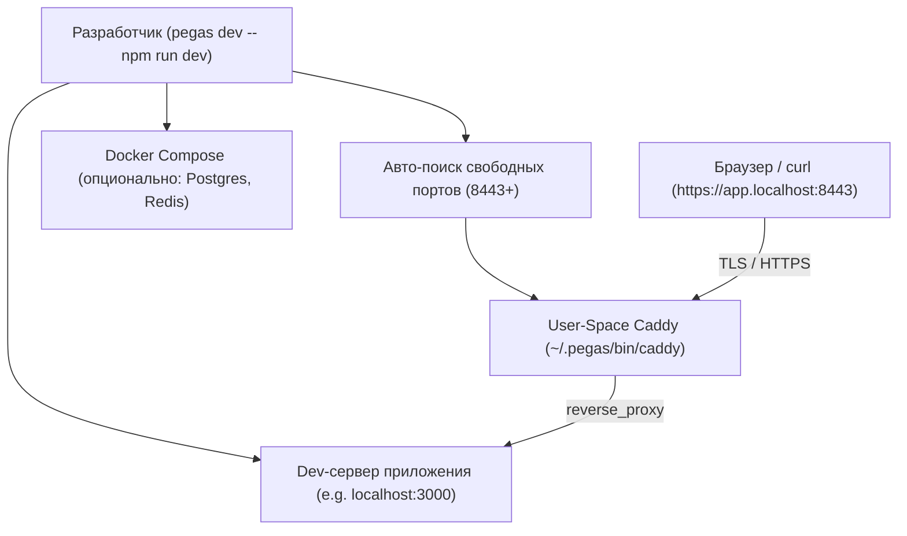

# Локальная разработка (`pegas dev`)

Команда `pegas dev` запускает локальный обратный прокси Caddy с поддержкой HTTPS и автоматическим роутингом на ваш локальный dev-сервер (Next.js, Vite, NestJS, Bun и т.д.), а также умеет автоматически поднимать вспомогательную инфраструктуру (БД, кэш).

---

## 1. Зачем нужен `pegas dev`?

В современной веб-разработке многие API и фичи требуют безопасного контекста (**HTTPS**) даже на localhost:
* Secure Cookies (флаги `Secure; SameSite=None`)
* WebCrypto API, Service Workers, WebAuthn/Passkeys, Geolocation
* Тестирование мульти-доменных сервисов (например, `app.localhost` и `api.localhost` с общими куками)
* Тестирование интеграций с внешними OAuth-провайдерами (Telegram WebApp, Google OAuth, VK ID), которые требуют HTTPS redirect_uri

Вместо сложной ручной настройки Nginx, mkcert или самоподписанных сертификатов доступен доверенный локальный HTTPS.

Для доверенного зелёного замка в браузере достаточно один раз выполнить:

```bash
npx pegas ca install
```

Команда генерирует локальный Root CA Pegas, регистрирует его в системном хранилище доверия и (на Linux) выдаёт бинарнику Caddy `cap_net_bind_service`, чтобы локальный шлюз мог использовать стандартный порт **443** без `sudo` при каждом запуске. Удалить CA можно командой `npx pegas ca remove`.

### Куда устанавливается сертификат (по платформам)

| Платформа | Хранилище | Что получает доверие |
|---|---|---|
| Linux (Debian/Ubuntu/Alpine) | `/usr/local/share/ca-certificates/pegas-root-ca.crt` + `update-ca-certificates` | curl, git, openssl, системные утилиты, Chrome/Chromium (через системный бандл) |
| Linux (RHEL/Fedora/CentOS) | `/etc/pki/ca-trust/source/anchors/pegas-root-ca.crt` + `update-ca-trust` | то же |
| macOS | System.keychain (`security add-trusted-cert`) | Safari, Chrome, системные фреймворки |
| Windows | user Root store (`certutil -user`, без UAC) | Edge, Chrome, системные API |
| WSL | **обе системы**: Windows user store (`certutil.exe` из interop) **и** Linux-side бандл (Debian/RHEL-путь) | браузеры в Windows + curl/node/git внутри WSL; плюс `setcap` на Linux-стороне для порта 443 |

`pegas ca remove` симметрично чистит все места установки, включая отзыв `cap_net_bind_service` (Linux/WSL) и «чужие» копии сертификата, установленные самим Caddy в trust-каталоги.

### Ограничения доверия (важно знать)

Не все рантаймы читают системное хранилище:
* **Firefox на Linux** использует собственный NSS-профиль — сертификат нужно добавить вручную (Настройки → Приватность → Сертификаты → Импорт) или через `certutil -A -t "C,," -n pegas -i ~/.pegas/ca/root.crt -d ~/.pki/nssdb`;
* **Node.js / Bun** имеют встроенный CA-лист. `pegas dev -- <команда>` автоматически прокидывает `NODE_EXTRA_CA_CERTS=~/.pegas/ca/root.crt` в дочерний процесс — `fetch()` из dev-сервера доверяет локальному HTTPS. Для standalone-запусков экспортируйте переменную вручную;
* **Python (requests)** использует certifi — задайте `REQUESTS_CA_BUNDLE=~/.pegas/ca/root.crt`.

### Диагностика: красный замок в браузере при успешном `pegas ca install` (WSL)

Редкий, но живой сценарий на WSL: `certutil.exe -addstore` из interop возвращает exit 0, **молча не записав** сертификат в Windows-хранилище. Симптом — браузер в Windows показывает предупреждение сертификата, хотя `pegas ca install` отчитался успехом. `isCaTrusted` это ловит (проверяет фактический fingerprint в сторе, а не вывод certutil), поэтому повторный `pegas ca install` или `pegas init` честно скажет «сертификат не установлен».

Ручное лечение — PowerShell-импорт (обходит interop-путь certutil):

```bash
powershell.exe -NoProfile -Command "Import-Certificate -FilePath '\\\\wsl.localhost\\<дистро>\\home\\<user>\\.pegas\\ca\\root.crt' -CertStoreLocation Cert:\CurrentUser\Root"
```

Если сценарий повторяется регулярно на вашей машине, стоит перевести установку Windows-стороны WSL на `Import-Certificate` как основной путь (текущая реализация использует certutil).

---

## 2. Архитектура работы `dev`



### Ключевые принципы:
1. **User-Space & Zero Root**:
   Бинарник Caddy запускается от имени текущего пользователя из `~/.pegas/bin/caddy`. Не создаются фоновые службы `systemd`, не требуются `sudo` или root-привилегии.
2. **Бесконфликтные порты (443/80 + fallback)**:
   По умолчанию используются стандартные порты `443` (`https`) и `80` (`http`) — браузер скрывает порт из адресной строки, оставляя чистый URL `https://web.my-app.localhost`. Если порт `443` занят или ОС запрещает непривилегированному процессу слушать низкие порты, Pegas не падает, а мягко откатывается на свободный порт (`8443`, затем следующий) и выводит подсказку `pegas ca install`.
3. **Управление дочерним процессом**:
   Команда после `--` (например, `pegas dev -- bun run dev`) запускается как дочерний процесс. Весь вывод (stdout/stderr) транслируется напрямую в консоль, а при нажатии `Ctrl+C` (SIGINT) Pegas корректно останавливает как Caddy, так и все запущенные дочерние подпроцессы.
4. **Умный авто-запуск инфраструктуры (`--infra`)**:
   Если в `docker-compose.yml` присутствуют сервисы баз данных или очередей (PostgreSQL, Redis, MySQL, MongoDB, RabbitMQ, Kafka), Pegas может запустить **только их**, не запуская сам веб-контейнер (ведь веб-приложение крутится на хосте в hot-reload режиме). При выходе из `dev` инфраструктура останавливается командой `docker compose stop`, сохраняя все тома данных (`volumes`).

---

## 3. Использование

### Базовый запуск вместе с приложением
```bash
# Next.js / Vite / React
npx pegas dev -- npm run dev

# Bun
npx pegas dev -- bun run dev

# Запуск с авто-поднятием инфраструктуры (Postgres, Redis) из compose
npx pegas dev --infra -- pnpm dev
```

### Доверенный HTTPS на чистом порту
```bash
# Один раз на машину — включает чистые URL вида https://web.my-app.localhost
npx pegas ca install

# Откат: удалить локальный CA из системы
npx pegas ca remove
```

### Автономый запуск прокси (без дочерней команды)
Если вы запускаете сервер из IDE или в отдельном терминале:
```bash
npx pegas dev
```
Caddy будет работать в терминале до нажатия `Ctrl+C`.

---

## 4. Конфигурация в `pegas.json`

В файле контракта `pegas.json` вы указываете локальные домены и поведение инфраструктуры:

```json
{
  "$schema": "https://netrunner714.ru/schemas/pegas.json",
  "projectName": "my-project",
  "bootInfra": true,
  "services": {
    "web": {
      "upstream": "web:3000",
      "domains": {
        "dev": ["web.my-app.localhost", "my-app.localhost"],
        "prod": ["my-app.ru"]
      }
    }
  }
}
```

* `domains.dev`: список доменов для локальной разработки (рекомендуется использовать зону `.localhost`, так как все современные браузеры резолвят её на `127.0.0.1` без изменения `/etc/hosts`).
* `bootInfra: true`: автоматически поднимать инфраструктурные контейнеры при `pegas dev` даже без флага `--infra`.

---

## 5. E2E Тестирование рантайма разработки (`e2e:dev`)

Для верификации работы локального прокси разработан автономный E2E-тест:

```bash
bun run test:e2e:dev
```

### Что проверяет тест:
1. **[Phase 0] Сборка бандла**: компиляция свежего `dist/index.js`.
2. **[Phase 1] Кэш Caddy (`~/.pegas/bin`)**:
   - Поиск исполняемого файла Caddy в глобальном управляемом кэше `~/.pegas/bin/caddy-v<версия>` (скачивается один раз при первом запуске, далее переиспользуется).
3. **[Phase 2] Разрешение коллизий портов**: искусственный захват порта 8443 фиктивным TCP-сервером и проверка, что Pegas динамически выделил свободный порт (8444).
4. **[Phase 3] Физический HTTPS-трафик (`curl`)**:
   - Создание изолированного проекта в `/tmp/` с контрактом `pegas.json`.
   - Запуск реального мок-сервера на случайном порту.
   - Запуск `pegas dev -- node mock-dev-server.cjs`.
   - Выполнение реального сетевого HTTPS-запроса через `curl -k --resolve demo-app.localhost:8443:127.0.0.1 https://demo-app.localhost:8443/api/profile`.
   - Валидация HTTP 200 OK, заголовков TLS и тела JSON-ответа.
   - Проверка чистого завершения всех процессов группы по SIGTERM.
5. **[Phase 4] Smart Infra Boot**:
   - Авто-детект инфраструктурных сервисов из compose.
   - Запуск сервиса через `docker compose up -d`.
   - Валидация вывода о готовности.
   - Автоматическая безопасная остановка (`docker compose stop`) без удаления томов при завершении сессии.
6. **[Phase 5] Гарантированная очистка**: удаление всех временных песочниц и остановка любых запущенных процессов.
