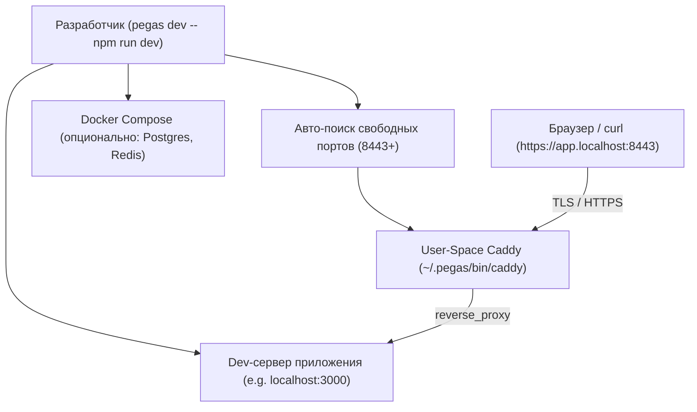

# Локальная разработка (`pegas dev`)

Команда `pegas dev` запускает локальный обратный прокси Caddy с поддержкой HTTPS и автоматическим роутингом на ваш локальный dev-сервер (Next.js, Vite, NestJS, Bun и т.д.), а также умеет автоматически поднимать вспомогательную инфраструктуру (БД, кэш).

---

## 1. Зачем нужен `pegas dev`?

В современной веб-разработке многие API и фичи требуют безопасного контекста (**HTTPS**) даже на localhost:
* Secure Cookies (флаги `Secure; SameSite=None`)
* WebCrypto API, Service Workers, WebAuthn/Passkeys, Geolocation
* Тестирование мульти-доменных сервисов (например, `app.localhost` и `api.localhost` с общими куками)
* Тестирование интеграций с внешними OAuth-провайдерами (Telegram WebApp, Google OAuth, VK ID), которые требуют HTTPS redirect_uri

Вместо сложной ручной настройки Nginx, mkcert или самоподписанных сертификатов, Pegas делает это в одну команду **без прав root (`sudo`)**.

---

## 2. Архитектура работы `dev`



### Ключевые принципы:
1. **User-Space & Zero Root**:
   Бинарник Caddy запускается от имени текущего пользователя из `~/.pegas/bin/caddy`. Не создаются фоновые службы `systemd`, не требуются `sudo` или root-привилегии.
2. **Бесконфликтные непривилегированные порты (8443+)**:
   Caddy слушает порт 8443 (HTTPS) и 8080 (HTTP). Если порт 8443 уже занят другим процессом, Pegas автоматически подбирает следующий свободный порт (8444, 8445...).
3. **Управление дочерним процессом**:
   Команда после `--` (например, `pegas dev -- bun run dev`) запускается как дочерний процесс. Весь вывод (stdout/stderr) транслируется напрямую в консоль, а при нажатии `Ctrl+C` (SIGINT) Pegas корректно останавливает как Caddy, так и все запущенные дочерние подпроцессы.
4. **Умный авто-запуск инфраструктуры (`--infra`)**:
   Если в `docker-compose.yml` присутствуют сервисы баз данных или очередей (PostgreSQL, Redis, MySQL, MongoDB, RabbitMQ, Kafka), Pegas может запустить **только их**, не запуская сам веб-контейнер (ведь веб-приложение крутится на хосте в hot-reload режиме). При выходе из `dev` инфраструктура останавливается командой `docker compose stop`, сохраняя все тома данных (`volumes`).

---

## 3. Использование

### Базовый запуск вместе с приложением
```bash
# Next.js / Vite / React
npx pegas dev -- npm run dev

# Bun
npx pegas dev -- bun run dev

# Запуск с авто-поднятием баз данных из compose
npx pegas dev --infra -- pnpm dev
```

### Автономый запуск прокси (без дочерней команды)
Если вы запускаете сервер из IDE или в отдельном терминале:
```bash
npx pegas dev
```
Caddy будет работать в терминале до нажатия `Ctrl+C`.

---

## 4. Конфигурация в `pegas.json`

В файле контракта `pegas.json` вы указываете локальные домены и поведение инфраструктуры:

```json
{
  "$schema": "https://netrunner714.ru/schemas/pegas.json",
  "projectName": "my-project",
  "bootInfra": true,
  "services": {
    "web": {
      "upstream": "web:3000",
      "domains": {
        "dev": ["my-app.localhost"],
        "prod": ["my-app.ru"]
      }
    }
  }
}
```

* `domains.dev`: список доменов для локальной разработки (рекомендуется использовать зону `.localhost`, так как все современные браузеры резолвят её на `127.0.0.1` без изменения `/etc/hosts`).
* `bootInfra: true`: автоматически поднимать инфраструктурные контейнеры при `pegas dev` даже без флага `--infra`.

---

## 5. E2E Тестирование рантайма разработки (`e2e:dev`)

Для верификации работы локального прокси разработан автономный E2E-тест:

```bash
bun run test:e2e:dev
```

### Что проверяет тест:
1. **[Phase 0] Сборка бандла**: компиляция свежего `dist/index.js`.
2. **[Phase 1] Локальный кэш Caddy (`.cache/bin`)**:
   - Поиск исполняемого файла Caddy в локальном репозиторном кэше `.cache/bin/caddy`, глобальном `~/.pegas/bin/` или `$PATH`.
   - Если бинарник скачивается или берется из системы, он автоматически сохраняется в `.cache/bin/caddy` для последующих оффлайн E2E-тестов без обращения к сети.
3. **[Phase 2] Разрешение коллизий портов**: искусственный захват порта 8443 фиктивным TCP-сервером и проверка, что Pegas динамически выделил свободный порт (8444).
4. **[Phase 3] Физический HTTPS-трафик (`curl`)**:
   - Создание изолированного проекта в `/tmp/` с контрактом `pegas.json`.
   - Запуск реального мок-сервера на случайном порту.
   - Запуск `pegas dev -- node mock-dev-server.cjs`.
   - Выполнение реального сетевого HTTPS-запроса через `curl -k --resolve demo-app.localhost:8443:127.0.0.1 https://demo-app.localhost:8443/api/profile`.
   - Валидация HTTP 200 OK, заголовков TLS и тела JSON-ответа.
   - Проверка чистого завершения всех процессов группы по SIGTERM.
5. **[Phase 4] Smart Infra Boot**:
   - Авто-детект инфраструктурных сервисов из compose.
   - Запуск сервиса через `docker compose up -d`.
   - Валидация вывода о готовности.
   - Автоматическая безопасная остановка (`docker compose stop`) без удаления томов при завершении сессии.
6. **[Phase 5] Гарантированная очистка**: удаление всех временных песочниц и остановка любых запущенных процессов.
