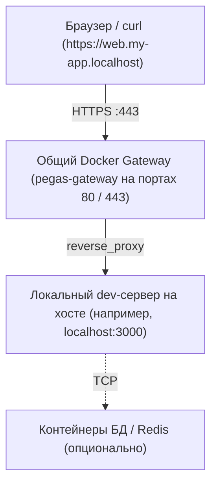

# Локальная разработка с HTTPS (`pegas connect` / `pegas disconnect`)

> How-to: получить доверенный HTTPS на `*.localhost` без запуска тяжелых прокси в каждом проекте и без изменения скриптов разработки.

В современной веб-разработке многие API и возможности браузера требуют безопасного контекста (**HTTPS**) даже при локальной разработке:
* Безопасные Cookie (с атрибутами `Secure; SameSite=None`)
* WebCrypto API, Service Workers, WebAuthn/Passkeys, Geolocation
* Мультидоменная маршрутизация (например, `app.localhost` и `api.localhost` с разделением кук)
* Внешние OAuth-интеграции (Telegram WebApp, Google OAuth, VK ID), требующие HTTPS redirect URL

Pegas решает эту задачу с помощью **единого общего Docker Gateway** (`pegas-gateway`) и прозрачной привязки хостовых портов (`pegas connect`).

### Чем это НЕ является

* **Не туннель наружу.** `*.localhost` резолвится только на вашей машине: ни
  публичного адреса, ни внешнего трафика. Если нужен URL из интернета
  (`https://xyz.ngrok.io`, `*.ts.net`) — это задача ngrok / cloudflared /
  Tailscale Funnel, и Pegas их не заменяет (но и не мешает).
* **Не прокси внутри проекта.** Ничего не запускается per-project: один gateway
  на машину обслуживает все домены.
* **Не правка dev-скриптов.** Ни `--https` флагов, ни конфигов vite/webpack:
  приложение слушает обычный HTTP, TLS терминируется снаружи.
* **Не root.** Caddy user-space, порты `:80/:443` без sudo (см.
  `docs/explanation/architecture.md`).

### Сравнение с альтернативами

| Подход | Доверенный сертификат | URL из интернета | Налог на проект |
|---|---|---|---|
| `vite --https`, `node --experimental-https` | самоподписанный → предупреждение браузера | нет | флаг/конфиг в каждом проекте |
| mkcert | да (локальный CA) | нет | сертификаты вручную на каждый домен, прокси поднимать самому |
| Traefik + Docker socket | да | нет | `/var/run/docker.sock` внутри прокси = root-эквивалент |
| nginx + свои конфиги | вручную | нет | шаблон на сайт, reload при изменениях |
| ngrok / cloudflared / tailscale funnel | да (публичный CA) | **да** | внешний сервис, аккаунт, трафик через чужую сеть |
| **Pegas** (`up` / `serve` / `connect`) | да (локальный Root CA, один раз) | нет — по дизайну | ноль: один бинарник, один общий gateway |

---

## 1. Установка доверенного Root CA

Для того чтобы браузеры и системные утилиты отображали валидный зеленый замок и доверяли локальным сертификатам без предупреждений, достаточно один раз выполнить на машине:

```bash
npx pegas ca install
```

Команда генерирует локальный Root CA Pegas (`~/.pegas/ca/root.crt`), регистрирует его в системном хранилище доверия ОС и браузеров. Удалить Root CA можно в любой момент командой `npx pegas ca remove`.

### Хранилища сертификатов по платформам

| Платформа | Хранилище | Что получает доверие |
|---|---|---|
| Linux (Debian/Ubuntu/Alpine) | `/usr/local/share/ca-certificates/pegas-root-ca.crt` + `update-ca-certificates` | curl, git, openssl, системные утилиты, Chrome/Chromium |
| Linux (RHEL/Fedora/CentOS) | `/etc/pki/ca-trust/source/anchors/pegas-root-ca.crt` + `update-ca-trust` | то же |
| macOS | System.keychain (`security add-trusted-cert`) | Safari, Chrome, системные фреймворки |
| Windows | User Root Store (`certutil -user`, без UAC) | Edge, Chrome, системные API |
| WSL | **Обе системы**: Windows user store + Linux bundle | Браузеры в Windows + curl/node/git внутри WSL |

### Ограничения доверия и нюансы

Некоторые среды используют собственные списки доверенных сертификатов:
* **Firefox на Linux**: использует собственный профиль NSS. Сертификат можно добавить через настройки браузера (Настройки → Приватность → Сертификаты → Импорт) или утилитой `certutil`:
  ```bash
  certutil -A -t "C,," -n pegas -i ~/.pegas/ca/root.crt -d ~/.pki/nssdb
  ```
* **Node.js / Bun**: используют встроенный список CA. Для межсервисных запросов по HTTPS передайте переменную окружения:
  ```bash
  export NODE_EXTRA_CA_CERTS="$HOME/.pegas/ca/root.crt"
  ```
* **Python (requests / httpx)**:
  ```bash
  export REQUESTS_CA_BUNDLE="$HOME/.pegas/ca/root.crt"
  ```

---

## 2. Архитектура общего Gateway

Вместо запуска изолированного Caddy-прокси в каждом проекте, Pegas использует **один глобальный Gateway-контейнер** (`pegas-gateway`), который слушает порты `80` и `443` на машине разработчика.



### Как это работает:
1. `pegas connect` считывает маршруты сценария `development` из файла `pegas.json`.
2. Если общий Gateway ещё не запущен, Pegas поднимает его в Docker.
3. Маршруты текущего проекта транслируются на `host.docker.internal:<порт>` и динамически регистрируются в Gateway через Caddy Admin API.
4. Разработчик запускает dev-сервер любимым нативным инструментом (`bun run dev`, `npm run dev`, `cargo run` и т.д.).
5. Браузер открывает `https://web.my-app.localhost` с валидным сертификатом без указания портов.
6. `pegas disconnect` удаляет маршруты проекта из Gateway при завершении работы.

---

## 3. Пошаговый рабочий процесс

### Шаг 1: Подключение проекта к Gateway
В каталоге проекта выполните:

```bash
npx pegas connect
```

Команда автоматически:
* Проверит наличие `pegas.json` и сценария `development`
* Поднимет или обновит общий Gateway-контейнер
* Зарегистрирует домены (например, `web.my-app.localhost`) на соответствующий локальный порт

### Шаг 2: Запуск вашего локального dev-сервера
Запустите dev-сервер стандартной командой проекта:

```bash
npm run dev
# или
bun run dev
# или
pnpm dev
```

Dev-сервер работает нативно на хосте со стандартным Hot Module Replacement (HMR) и доступом к IDE отладчикам.

### Шаг 3: Отключение проекта
Когда разработка завершена или вы переключаетесь на другую задачу:

```bash
npx pegas disconnect
```

Gateway освободит маршруты текущего проекта, не затрагивая маршруты других активных проектов.

---

## 4. Конфигурация сценария в `pegas.json`

Маршруты локальной разработки настраиваются в сценарии `development`:

```json
{
  "name": "my-project",
  "scenarios": {
    "development": {
      "routes": [
        {
          "host": "web.my-app.localhost",
          "to": "host.docker.internal:3000"
        },
        {
          "host": "api.my-app.localhost",
          "to": "host.docker.internal:4000"
        }
      ]
    }
  }
}
```

* Зона `*.localhost` по стандарту RFC 6761 автоматически резолвится всеми современными ОС и браузерами в `127.0.0.1` без необходимости редактировать `/etc/hosts`.
* Директива `to` указывает на `host.docker.internal:<порт>`, благодаря чему контейнер Caddy перенаправляет запросы обратно на хост разработчика.
