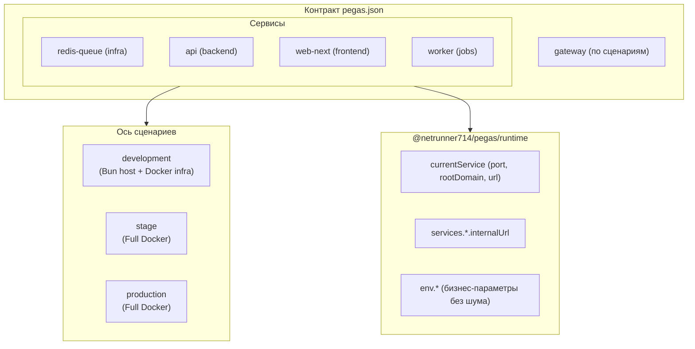

# RFC: Бескомпромиссная архитектура контракта Pegas (v3)

> **🔒 Внутренний документ pegas.** Не является пользовательской документацией.
> **Статус: реализовано в pegas 3.0.0** — план выполнен, перенесён сюда как историческая запись.
> Актуальное поведение описывает публичная документация: README.md, docs/reference/contract.md, llms.txt.

> **Статус:** Обсуждение и фиксация спецификации (Draft)  
> **Дата:** 4 ноября 2026 г.  
> **Связанный пример:** [`example.json`](./example.json) — эталон v3-контракта (до перехода на генерацию из схемы); [`RFC_UX_V3.md`](./RFC_UX_V3.md) — UX-путь и реестр решений.

---

## 1. Введение и манифест

Исторически инструменты оркестрации и деплоя заставляли разработчиков балансировать между двумя крайностями:
1. **Свалка неявных переменных:** раздутые файлы `.env` на 50+ переменных, где перемешаны адреса баз данных, порты хоста, флаги логирования и секреты.
2. **Невидимая магия дефолтов:** когда инструмент неявно предполагает, что «если порт не указан, значит 3000», а «если рантайм не задан, значит везде один и тот же докер».

**Цель архитектуры Pegas v3:**  
Перейти к философии **True Declarative Platform as Code**:
> **«Никакой неявной магии, никаких невидимых дефолтов. Если поведение зависит от среды — оно обязано быть задекларировано явно для каждого сценария».**

Контракт становится не просто инструкцией для генерации `docker-compose.yml`, а **единым и окончательным источником правды (Single Source of Truth) о топологии всей системы**.

---

## 2. Семь столпов новой архитектуры



### Столп 1: Полная ликвидация глобального `contract.env`
* **Проблема:** Глобальный котел переменных засорял все контейнеры подряд. Фронтенд получал креды базы данных и интервалы воркера, увеличивая риск утечки ключей в клиентский бандл.
* **Решение:** Корень контракта свободен от `env`. Переменные живут **исключительно внутри конкретного сервиса** (`services.<name>.env`), который их потребляет.

---

### Столп 2: Универсальная ось сценариев (Zero Scalars)
* **Проблема:** Попытка объявить свойство скаляром (например, `"image": "redis:7-alpine"` или `"APP_PORT": "4000"`) порождает скрытые допущения. В реальной жизни в dev образ тянут с публичного Docker Hub, а на проде — из защищенного приватного зеркала облака (`cr.yandex/...`) или с жестко зафиксированным SHA256-хешем от атак на цепочку поставок.
* **Решение:** Каждое зависящее от среды свойство (`image`, `ports`, `port`, `command`, `volumes`, `runtime`, `domains`, `env`, `cors`) объявляется как строгая мапа сценариев:
  ```json
  "image": {
    "development": "redis:7-alpine",
    "stage": "redis:7-alpine",
    "production": "redis:7-alpine"
  }
  ```
  Никаких исключений даже для статики. Это исключает двусмысленность и гарантирует 100% покрытие проверок в `pegas check`.

**Источник истины о наборе сценариев — обязательное корневое поле `scenarios`:**

```json
"scenarios": ["development", "stage", "production"]
```

Правила:
1. Список обязателен; минимум один сценарий; пустой список — ошибка валидации.
2. Каждая сценарная карта (`gateway`, `image`, `port`, `ports`, `command`, `volumes`, `runtime`, `domains`, `env`, `cors`, `healthcheck`, `build`, `dependsOn`) обязана содержать **все** ключи из `scenarios` и **только** их: отсутствующий ключ и лишний ключ (включая опечатку) — ошибки валидации, а не игнор.
3. Никакой неявной нормализации имён: `dev` в карте при `development` в списке — ошибка с подсказкой. Имена должны совпадать байт-в-байт; канонизация имён — фича v2-legacy и в v3 не наследуется.
4. Имена сценариев — `[a-z0-9-]+` (lowercase): валидны в compose-проектах, labels и путях без экранирования.
5. `deploy -s <scenario>` валидирует имя флага по списку до начала работы: опечатка ловится с подсказкой доступных сценариев, а не на середине деплоя.

---

### Столп 3: Гранулярный рантайм оркестрации (только `driver`)
* **Проблема:** Глобальный `"runtime": "docker"` в корне — это ложь. В реальной разработке (Hybrid Development) базы данных (Redis, Postgres) крутятся в Docker, а код приложений (Fastify, Next.js) запускается напрямую через Bun ради субсекундного HMR.
* **Решение:** Каждый сервис декларирует свой рантайм для каждого сценария — ровно одно поле `driver`:
  ```json
  "runtime": {
    "development": { "driver": "bun" },
    "stage":       { "driver": "docker" },
    "production":  { "driver": "docker" }
  }
  ```
* **Единая семантика `pegas deploy -s <scenario>`:** команда **всегда поднимает только сервисы с `driver: "docker"`** (генерирует эфемерный манифест, ждёт readiness, регистрирует маршруты). Сервисы с host-драйвером pegas не трогает в принципе — их запускает пользователь самостоятельно (`bun run dev` и т.п.).
* **Поля `up` в контракте нет и не будет.** Команда запуска host-сервиса — территория `package.json` проекта; дублировать её в контракте значило бы создать второй источник правды, который pegas не может держать синхронным (pegas не мутирует scripts). Контракт не обещает того, что не исполняет. Поле `command.<scenario>` остаётся командой процесса **внутри контейнера** (`redis-server --appendonly yes`).
* **Отдельный супервизор host-процессов (`pegas dev`) — отклонён**: pegas не следит за dev-процессами, не объединяет их логи и не управляет их жизненным циклом. Граница ответственности: pegas владеет контейнерами и шлюзом, dev-процессы — территория разработчика.

---

### Столп 4: Граница безопасности сети (`port` vs `ports`) и честные `domains`
* **`domains` — строго для HTTP/Web-сервисов**: Базы данных и очереди (Redis, Postgres) говорят по TCP, а не по HTTP. Вешать на них домены обратного прокси — фикция. У инфры нет `domains`.
* **`port`** — логический TCP-порт, на котором сервис принимает соединения (используется внутренними роутерами и шлюзом).
* **`ports`** — физический проброс на сетевую карту хоста:
  ```json
  "ports": {
    "development": ["6379:6379"],
    "stage": [],
    "production": []
  }
  ```
  - В `development`: порты баз данных открыты на хост, чтобы локальный процесс Bun и инструменты разработчика (DBeaver, redis-cli) могли подключиться.
  - В `stage` / `production`: порты закрыты (`[]`). Базы изолированы внутри сети Docker, а весь трафик приложений идёт строго через Gateway (80/443).

---

### Столп 4a: Роли и наружность сервисов (производные правила)

Роль сервиса — не поле контракта, а **производная** от его декларации. Три статуса наружности, и только они:

| Статус | Признак | Что получает |
|---|---|---|
| `web` | есть `domains` | HTTP-маршрут через gateway (`port` обязателен); `ports: []` вне development |
| `public-tcp` | непустой `ports` вне development + `publicHost` | прямая публикация TCP с DNS-именем; Caddy не участвует; TLS — ответственность контейнера |
| закрытый (`infra`, `app` без маршрута) | нет `domains`, `ports: []` вне development | контейнер в сети, алиас, без наружности |

Правила:
1. Роль вычисляется: `domains` → web; нет `domains` + `image` без `build` → infra; нет `domains` + `build` → app-без-маршрута. Поля `role` в контракте нет.
2. **`domains` зарезервирован строго за HTTP-маршрутами шлюза.** Домен у не-HTTP сервиса — ошибка валидации, не игнор. Мотивировка — выученный урок v2: контракт tf2-trade-exchange нёс фиктивные домены на redis-queue (мусор, который v2 позволял записать), а флагманский публичный TCP-провайдер vibe-db (`pg18.*`) через `domains` выразить нельзя — смешение этих смыслов и породило запрет.
3. Публичное имя TCP-сервиса — отдельное поле `publicHost` (сценарная карта, как `domains`): DNS-запись на хост + публикация `ports`; Caddy его не маршрутизирует. TLS для прямых подключений — ответственность сервиса (паттерн vibe-db: api-сервис синкает LE-сертификат шлюза в контейнер postgres).
4. `public-tcp` — не отдельная роль, а статус поверх роли: managed-БД (infra) или свой TCP-сервер (app) публикуются одинаково.
5. Замкнутый валидатор в `check`: `domains` без `port` → error; `domains` при host-драйвере **не-development**-сценария → error (в development dev-домены host-сервисов легитимны — их маршрутизирует `pegas connect` на `host.docker.internal:<port>`); непустой `ports` вне development без `publicHost` → error; `publicHost` без непустого `ports` → error; всё остальное — закрытый сервис.
6. В development `ports` без `publicHost` разрешён и не требует обоснования: отладочный доступ к базе с хоста — норма (`6379:6379` для redis-cli).

Переход v2→v3 выполняется ручной правкой pegas.json (агентом или владельцем): фиктивные домены у не-HTTP сервисов удаляются при переносе — `check` подсветит их, если забыть.

**Почему в контракте нет `replicas`.** Поле не исполняется никем: pegas его не читает, docker-compose в обычном режиме не поддерживает реплики (только swarm). Декларация без исполнителя — то же невыполненное обещание, что и отвергнутое `up`. Размножение экземпляров вернётся в контракт только вместе с реальным драйвером (swarm/k8s или декларативное размножение в генераторе) и с правилами конкурентности — как minor-добавление, не ломающее старые контракты.

### Столп 4b: Зависимости между сервисами (`dependsOn`)

`dependsOn` — сценарная карта (Zero Scalars без исключений): зависимости между сервисами реально различаются по средам.

```json
"dependsOn": {
  "development": {},
  "stage": { "redis-queue": { "condition": "service_healthy" } },
  "production": { "redis-queue": { "condition": "service_healthy" } }
}
```

Правила:
1. Значение — объект `map<serviceName, { condition }>`; `condition` обязателен и принимает `service_started` | `service_healthy` (как в compose). Массив строк из v2 (`["db"]`) не используется: он терял информацию и имел скрытый дефолт.
2. **`dependsOn` при host-драйвере сценария — ошибка валидации.** Супервизора host-процессов нет (см. решение №7 UX-RFC): pegas не запускает процесс и ни на что не ждёт — зависимость была бы обещанием без исполнителя (тот же паттерн, по которому отвергнуты `up` и `replicas`). Пустой объект `{}` — корректное значение для сценариев с host-драйвером.
3. Имя сервиса в ключе обязано существовать в `services` — иначе error с подсказкой.
4. `dependsOn` — это ожидание readiness при **порядке запуска docker-сервисов**; после старта устойчивость к недоступности соседа — ответственность кода приложения (retry-логика), не контракта.

При ручном переносе с v2: массив строк разворачивается в карту с `condition: "service_started"` (если в v2 condition не был задан); для сценариев с host-драйвером — пустой объект.

### Столп 5: Секреты со строгим скоупом (Интерфейс зависимостей, а не конфигурация)
* **Разделение сущностей:**
  - `env` — это **значения** (конфигурация), которые зависят от среды (`pretty` vs `json`, `localhost` vs `internalUrl`), поэтому они обязаны делиться по сценариям.
  - `secrets` — это **имена ключей** (декларация интерфейса). Код сервиса `api` ожидает переменную `DATABASE_URL` всегда — и на ноутбуке в dev, и на проде. Менять список необходимых ключей по сценариям — бессмысленное дублирование.
* **Решение:** Секреты вынесены из корня проекта внутрь каждого сервиса в виде **плоского массива строк**:
```json
"services": {
  "web-next": {
    "secrets": ["SESSION_SECRET"]
  },
  "api": {
    "secrets": [
      "DATABASE_URL",
      "REDIS_URL",
      "TRADE_URL_ENCRYPTION_KEY",
      "STEAM_API_KEY"
    ]
  },
  "alerting-bot": {
    "secrets": [
      "TELEGRAM_BOT_TOKEN",
      "TELEGRAM_ADMIN_CHAT_ID"
    ]
  }
}
```
Фронтенд физически не может запросить секрет, предназначенный бэкенду. Значения ключей подставляются из локального `.env` (в dev) или секрет-хранилища CI/CD (в prod), но сам контракт интерфейса лаконичен и неизменен.

---

### Столп 6: Библиотека рантайма `@netrunner714/pegas/runtime`
Вместо ручного парсинга нетипизированных строк из `process.env` код импортирует живой контекст Пегаса:

```ts
import { currentService, services, env } from "@netrunner714/pegas/runtime";

// 1. Собственные параметры сервиса:
app.listen({ port: currentService.port, host: "0.0.0.0" });

// 2. Домен для cookie (вычисляется автоматически из domains):
reply.setCookie("session", token, {
  domain: currentService.rootDomain // "localhost" в dev, ".tf2-exchange.com" в prod
});

// 3. Service Discovery без ручных ENV:
const apiRes = await fetch(`${services.api.internalUrl}/health`);
```

#### Что это удаляет из `env` и сервисов:
* **Удалено 70% мусорных переменных**: больше не нужны `API_PORT`, `API_HOST`, `REDIS_URL`, `WEB_URL`, `ADMIN_URL`, `SESSION_COOKIE_DOMAIN`, `NODE_ENV`. Конфиг становится предельно лаконичным.
* **Удалена ручная секция `cors`**:
  - *В коде приложения*: бэкенд настраивает CORS в одну строчку через SDK:
    ```ts
    app.register(fastifyCors, {
      origin: [services["web-next"].url] // Автоматически знает актуальный домен фронтенда для текущей среды
    });
    ```
  - *На уровне Gateway*: если за CORS отвечает обратный прокси Пегаса, движок **уже знает** все домены проекта (`allProjectDomains`) и настраивает заголовки автоматически.
  - **Золотой принцип:** *«Никогда не заставляй разработчика декларировать то, что платформа может вычислить со 100% точностью из уже существующих данных»*. Любой ручной список доменов в `cors` — это неизбежная рассинхронизация при смене домена.

---

### Столп 7: Запрет на ветвление по средам в коде приложения
**Антипаттерн:**
```ts
// ПЛОХО: код знает о названиях сред
if (scenario === 'development') {
  setupPrettyLogger();
}
```
*Почему это ломается:* Добавление четвертого сценария (`preview`, `testing`, `canary`) требует правок в бизнес-логике.

**Золотой стандарт Pegas:**
> **Сценарий определяет конфигурацию. Конфигурация управляет кодом. Код 100% слеп к названиям сред.**

В контракте:
```json
"LOG_FORMAT": {
  "development": "pretty",
  "stage": "json",
  "production": "json"
},
"AUTO_MIGRATE": {
  "development": "true",
  "stage": "false",
  "production": "false"
}
```
В коде приложения:
```ts
// ХОРОШО: код выполняет инструкцию, не интересуясь именем сценария
const logger = initLogger({ format: env.LOG_FORMAT });
if (env.AUTO_MIGRATE === 'true') {
  await runMigrations();
}
```

---

## 3. Сравнение «Было» vs «Стало»

| Критерий | Pegas v2 (Старый подход) | Pegas v3 (Новый контракт) |
| :--- | :--- | :--- |
| **Корень `env`** | Общий котел на 35+ переменных | Удален полностью |
| **Рантайм оркестрации** | Глобальный `"runtime": "docker"` | Посервисная карта `runtime` с одним полем `driver` по сценариям; поля `up` нет |
| **Команды хоста и контейнера** | Смешивались под одним ключом `command` | Команда контейнера — `command` (карта сценариев); запуск host-сервисов — вне контракта (`package.json`) |
| **Dev-опыт** | Либо всё в докере (медленно), либо ручные запуски | Нативный гибрид: infra в Docker, app в Bun с HMR |
| **Сборка (`build`)** | Статичный блок | Разбит по сценариям (`development: null`) |
| **Безопасность портов** | Порты светились на всех серверах | В dev открыты на хост, в prod закрыты (`[]`) |
| **Домены баз данных** | Фиктивные HTTP-домены для Redis/Postgres | Удалены: `domains` строго для HTTP/Web |
| **Healthcheck в Dev** | Docker `["CMD", "wget"]` для процессов хоста | HTTP ping URL для host-сервисов, `null` для воркеров; compose-объект — для docker-сервисов (эталон: example.json) |
| **Роли сервисов** | Ручной костыль `"role": "infra"` | Удален: роль вычисляется автоматически |
| **Service Discovery** | Десятки ручных `${services.x.url}` в env | Напрямую через `@netrunner714/pegas/runtime` |
| **Код приложения** | Завязан на `process.env` и `if (isProd)` | Слепой к средам, параметризованный контрактом |
| **Набор сценариев** | Неявно захардкожен (dev/stage/prod) | Явное корневое поле `scenarios`; карты обязаны совпадать с ним байт-в-байт |
| **Зависимости** | Массив строк `dependsOn: ["db"]` без условий | Сценарная карта `map<service, {condition}>`; при host-драйвере запрещены |
| **Реплики** | Поле без исполнителя | Удалены из контракта (см. столп 4a) |
| **Внешний TCP-доступ** | Не выражался (смешивался с `domains`) | Статус `public-tcp`: `ports` + `publicHost`, без участия шлюза |

---

## 4. Следующие шаги реализации

Порядок этапов соответствует решениям UX-RFC (см. `RFC_UX_V3.md`, реестр §7). Каждый этап заканчивается работающим, коммитабельным состоянием.

1. **Схема и парсер (`schemas/pegas.json`, `src/types.ts`, `src/contract.ts`)**
   - v3-контракт целиком: `scenarios` (корень), сценарные карты (`gateway`, `image`, `port`, `ports`, `command`, `volumes`, `runtime`, `domains`, `env`, `cors`, `healthcheck`, `build`, `publicHost`, `dependsOn`), посервисные `secrets: []`.
   - Удаление корневого `env`, `role`, `replicas`, `envFile` (замещён `secrets`), `devGateway` (замещён `gateway`).
   - Схема — единственный корень: описания полей и значения-примеры (`examples`/`default`) живут в ней.
   - Эталонный контракт — генерируемый артефакт схемы (`scripts/gen-example.ts`): schema → example; ручной `example.json` не поддерживается. Публикация: npm (`files`) + сайт (`/examples/pegas.json`); в клиентские репо эталон не копируется.
   - CI: тест «эталон валиден по схеме»; `docs:check` следит, что llms.txt и документация не отстали от схемы.
2. **Линтер контракта (`pegas check`)** — рид-онли, со всеми правилами из столпов 2, 4, 4a, 4b, 5:
   - полнота матрицы: каждая карта содержит все ключи из `scenarios` и только их;
   - `domains` без `port` / при host-драйвере → error; непустой `ports` вне development без `publicHost` → error; `publicHost` без `ports` → error;
   - `dependsOn` при host-драйвере → error; имена зависимостей существуют в `services`;
   - паритет `services.*.secrets` ↔ `.env` (если файл существует);
   - ошибки машиночитаемы (`--json`), каждая с подсказкой «что дописать».
3. **Переход v2 → v3 — ручной (без команды migrate)**:
   - валидатор `check` уже даёт достаточно подсказок для ручной правки: каждое v2-поле подсвечивается с указанием замены (`envFile` → `secrets`, `devGateway` → `gateway`, `role` → вычисляется, скаляры → сценарные карты, `dependsOn`-массив → карта);
   - правка выполняется агентом или владельцем в контексте репо: уникальные проекты требуют осмысленного разреза корневого `env` по сервисам-потребителям;
   - харвест-механики и код migrate не создаются вовсе;
   - переход фиксируется в CHANGELOG 3.0.0 как инструкция (руководство по переводу контракта).
4. **`pegas init` — тонкий scaffolder** (решения №1–3 UX-RFC): маркер-блок `AGENTS.md`, `docs/pegas.md`, `.pegas/`, записи `.gitignore`. Без харвестов, env-генерации, Dockerfile, compose-хирургии, версионных проверок.
5. **Рантайм-фильтр по `driver`** (`src/commands/deploy.ts`, `runtime-compose.ts`):
   - `deploy -s <scenario>` поднимает только `driver: "docker"`-сервисы сценария; валидация имени сценария по `scenarios` до старта;
   - эфемерный манифест из v3-карт; `dependsOn`-условия пробрасываются в манифест;
   - статус `public-tcp` (`ports` + `publicHost`) публикуется напрямую, минуя шлюз.
6. **Rename `link`/`unlink` → `connect`/`disconnect`** + чистка кода:
   - `src/help.ts` (реестр команд), `llms.txt`, README, туториалы — производные перегенерированы;
   - удаление: `uninstall` (+тесты), `tryLocalDelegation` в `index.ts`, обёртка dev-скриптов, харвесты из `init`;
   - старые имена дают явную ошибку с подсказкой (без алиасов).
7. **Runtime SDK `@netrunner714/pegas/runtime`** (столп 6): транспорт `PEGAS_*` env + файл контекста; типы из кода, без codegen-команды в первой итерации.
8. **Релиз 3.0.0**: CHANGELOG с разделом миграции (breaking: контракт v3, rename команд, смерть `uninstall`/`npx`-делегации), e2e-сьют, публикация.

Этапы 1–3 дают самодостаточную ценность (контракт + аудит + миграция без нового рантайма) — «вечный рефакторинг без выхода продукта» исключён структурой.
